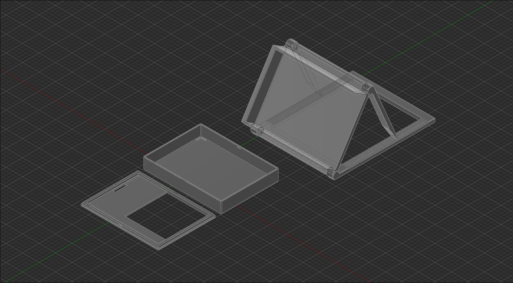
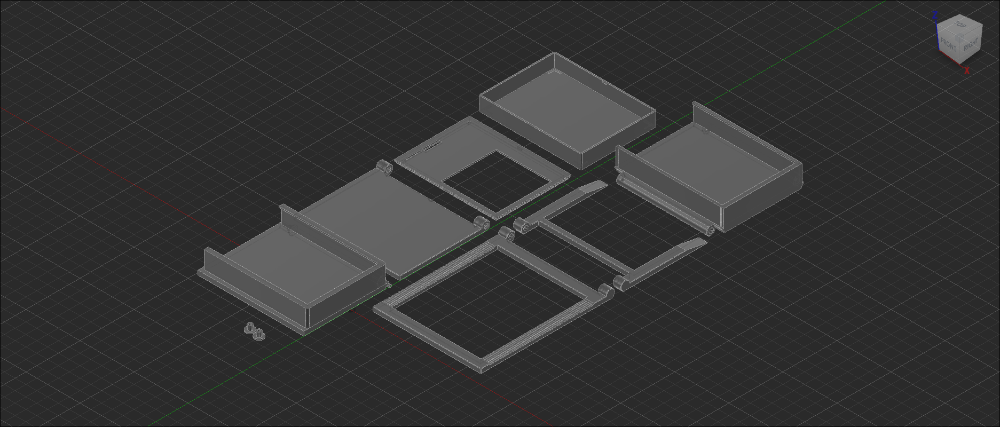

# LED Matrix Enclosure

Desk & wall mountable enclosure for my PCB from the first week
with a ratchet mechanism for adjusting the angle of the display

There are two holder types the ratcheted holder and the friction fit holder which has a plug to keep the hinge in one of 12 angles

